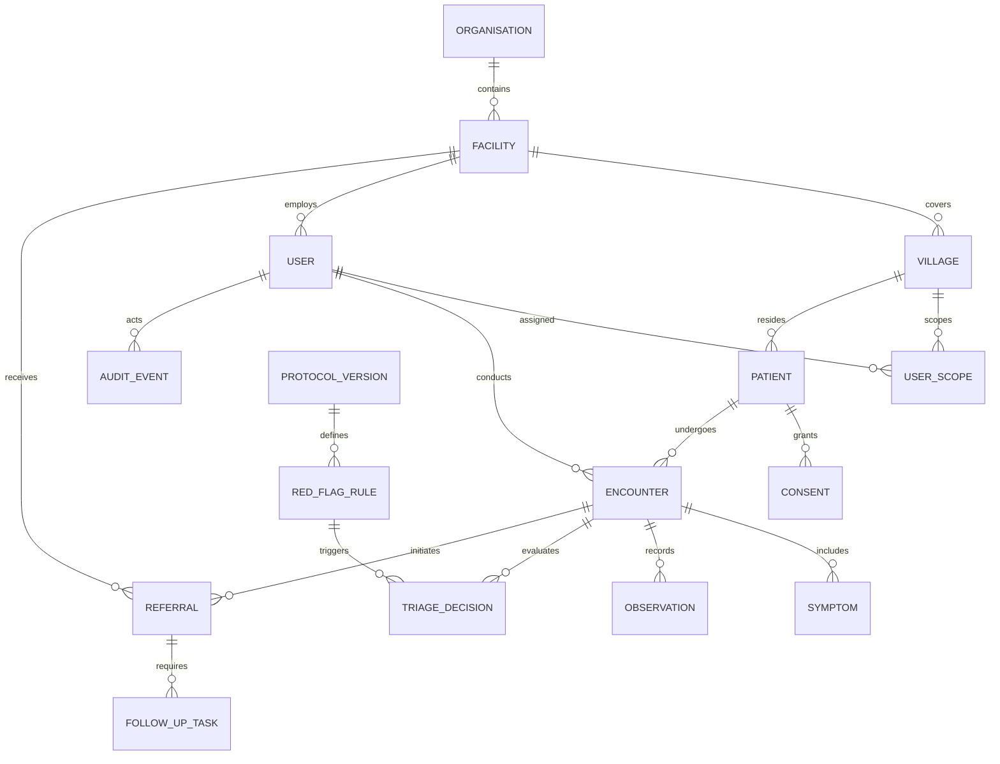

# ArogyaSaathi — Core Data Model Specification
**Document ID:** DOC-DAT-001  
**Product:** ArogyaSaathi  
**Status:** Proposed Relational Entities & Relationships (Subject to Clinical & Privacy Review)  

---

## 1. Entity Relationship Overview

The data model is structured around 6 core domains:
1. **Organizational Hierarchy & Access Scopes**
2. **Patient Identity & Purpose-Bound Consent**
3. **Clinical Encounters & Symptom Records**
4. **Deterministic Safety Rules & Triage Evaluations**
5. **Closed-Loop Referral Tracking**
6. **Immutable Audit & Event Logs**

---

## 2. Core Entity Definitions (Proposed)

### 2.1 Identity, Facilities & Geographic Scoping
- **`organisations`**: Top-level entity (e.g. State Department of Health & Family Welfare, District Health Society).
- **`facilities`**: Physical healthcare delivery centres (`facility_type`: `SUBCENTRE`, `PHC`, `CHC`, `DISTRICT_HOSPITAL`, `MEDICAL_COLLEGE`).
- **`villages`**: Census-mapped rural revenue villages linked to specific PHCs and sub-centres.
- **`users`**: System actors with hashed credentials, account status, and designated clinical role (`ASHA`, `ANM`, `DOCTOR`, `FACILITY_STAFF`, `PUBLIC_HEALTH_OFFICER`, `ADMINISTRATOR`).
- **`user_scopes`**: Join table binding users to specific facilities, blocks, and village clusters, enforcing spatial authorization.

### 2.2 Patient Registry & Consent Lifecycle
- **`patients`**: Core demographic record (`patient_id` [UUID], `display_id` [e.g. `AS-2026-00123`], `first_name`, `last_name`, `date_of_birth`, `gender`, `contact_number`, `village_id`, `is_synthetic`).
- **`consents`**: Purpose-specific consent record (`consent_id`, `patient_id`, `purpose` [`ROUTINE_CARE`, `EMERGENCY_REFERRAL`, `ANONYMIZED_SURVEILLANCE`], `status` [`ACTIVE`, `REVOKED`, `EXPIRED`], `captured_by_user_id`, `captured_at`, `revoked_at`, `consent_version`).

### 2.3 Clinical Encounters & Observations
- **`encounters`**: Clinical contact record (`encounter_id`, `patient_id`, `recorder_user_id`, `facility_id`, `encounter_type` [`HOME_VISIT`, `OPD_CLINIC`, `OUTREACH_CAMP`], `encounter_date`, `status` [`COMPLETED`, `CORRECTED`, `VOIDED`]).
- **`symptoms`**: Structured extracted symptoms (`symptom_id`, `encounter_id`, `symptom_name`, `duration_days`, `severity` [`MILD`, `MODERATE`, `SEVERE`], `is_primary`, `extracted_from_voice`).
- **`observations`**: Quantitative clinical measurements (`observation_id`, `encounter_id`, `measurement_type` [`SYSTOLIC_BP`, `DIASTOLIC_BP`, `RANDOM_BLOOD_SUGAR`, `FASTING_BLOOD_SUGAR`, `PULSE`, `TEMPERATURE`], `value_numeric`, `unit`, `measured_at`).

### 2.4 Deterministic Safety Engine & Clinical Protocols
- **`protocol_versions`**: Formally approved clinical rulesets (`protocol_id`, `protocol_code`, `version_tag` [e.g. `MATERNAL_DANGER_SIGNS_V1.2`], `approved_by_clinical_lead`, `effective_from`, `is_active`).
- **`red_flag_rules`**: Discrete deterministic criteria (`rule_id`, `protocol_id`, `rule_code`, `rule_logic_json`, `escalation_level` [`ROUTINE`, `PRIORITY`, `EMERGENCY`]).
- **`triage_decisions`**: Immutable record of safety evaluations (`decision_id`, `encounter_id`, `protocol_id`, `triggered_rule_ids`, `recommended_action`, `evaluated_at`, `human_override_actor_id`, `human_override_reason`).

### 2.5 Referrals & Care Continuity
- **`referrals`**: Closed-loop referral packet (`referral_id`, `encounter_id`, `patient_id`, `referring_user_id`, `receiving_facility_id`, `reason_for_referral`, `urgency` [`ROUTINE`, `URGENT`, `EMERGENCY`], `status` [`PENDING`, `ACKNOWLEDGED`, `ARRIVED`, `COMPLETED`, `LOST_TO_FOLLOW_UP`], `disposition_notes`, `completed_at`).
- **`follow_up_tasks`**: Post-referral or chronic monitoring assignments (`task_id`, `patient_id`, `assigned_user_id` [ASHA], `task_type` [`POST_REFERRAL_CHECK`, `BP_MONITORING`, `MEDICATION_ADHERENCE`], `due_date`, `completed_at`, `completion_notes`).

### 2.6 Tamper-Evident Governance
- **`audit_events`**: Append-only log of all security, clinical, and data access events (`event_id`, `actor_user_id`, `action_type` [`READ_PATIENT`, `CREATE_ENCOUNTER`, `OVERRIDE_TRIAGE`, `EXPORT_REPORT`, `LOGIN_FAILURE`], `entity_type`, `entity_id`, `ip_address`, `timestamp`, `metadata_json`).

