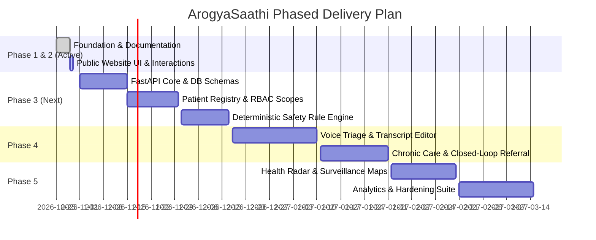

# ArogyaSaathi — Phased Implementation Roadmap
**Document ID:** DOC-ROA-001  
**Status:** Canonical Engineering Roadmap  

---

## 1. Phased Delivery Overview

---

## 2. Phase Breakdown & Acceptance Criteria

### Phase 1 & 2: Project Foundation, Design Tokens, & Premium Public Website (CURRENT SESSION)
- **Deliverables:**
  - Audited monorepo structure with Next.js web application and FastAPI scaffolding.
  - Comprehensive documentation suite covering architecture, data models, APIs, and design tokens.
  - Complete public website UI (`/`, `/features`, `/how-it-works`, `/about`, `/resources`, `/contact`, `/login`, `/request-access`).
  - Active bilingual support (English / Hindi).
  - Responsive layouts (360px mobile to 1920px desktop).
  - Clean TypeScript compilation, linting, and production build verification.
- **Acceptance Criteria:**
  - Zero TypeScript errors.
  - Zero dead navigation buttons.
  - Transparent disclaimers on planned features and target metrics.

### Phase 3: Core Backend, Synthetic Registry, & Deterministic Safety Engine (Next Phase)
- **Deliverables:**
  - PostgreSQL schema migrations with Alembic.
  - JWT authentication with organization, facility, and village spatial scoping.
  - Patient registry with digital consent capture, lookup, and synthetic seed fixtures.
  - Isolated deterministic rule engine evaluating fever, maternal warning signs, and respiratory distress.
  - Basic role-specific dashboard views (ASHA, Doctor, PHC staff) backed by synthetic records.

### Phase 4: Voice Triage Audio Pipeline & Chronic Care Workflows
- **Deliverables:**
  - Audio recording client component with waveform display, playback, and transcript correction editor.
  - Structured symptom extraction with manual fallback.
  - Blood pressure and glucose tracking with date-stamped charts and due/overdue queue generation.
  - Closed-loop referral workflow (create -> facility acknowledge -> arrive -> doctor disposition).

### Phase 5: Health Radar Surveillance & Production Hardening
- **Deliverables:**
  - Aggregated syndromic surveillance map using k-anonymized village clusters.
  - Candidate outbreak alert generation and epidemiological review log.
  - End-to-end Playwright browser test suite.
  - Security audit and DPDP Act compliance review.

