# ArogyaSaathi — Information Architecture & Routing Specification
**Document ID:** DOC-IA-001  
**Product:** ArogyaSaathi  
**Status:** Approved Architecture  

---

## 1. Global Sitemap & Route Hierarchy

```mermaid
graph TD
    ROOT["/ (ArogyaSaathi Root)"]
    
    %% Public Marketing Pages
    ROOT --> PUB["(Public) Marketing & Informational"]
    PUB --> P_HOME["/ (Homepage)"]
    PUB --> P_FEAT["/features (9 Core Modules & Capabilities)"]
    PUB --> P_HIW["/how-it-works (5-Step Coordination Journey)"]
    PUB --> P_ABT["/about (Mission, Principles & Responsible AI)"]
    PUB --> P_RES["/resources (Guides, FAQs & Documentation)"]
    PUB --> P_CNT["/contact (Pilot Inquiries & Help Form)"]
    
    %% Auth Routes
    ROOT --> AUTH["(Auth) Controlled Access Entry Points"]
    AUTH --> A_LOG["/login (Role-based Worker Sign In)"]
    AUTH --> A_REQ["/request-access (Institutional Pilot Onboarding)"]
    
    %% Future Healthcare Operations (Protected)
    ROOT -.-> DASH["(Dashboard) Role-Protected Operations [Phase 3+]"]
    DASH -.-> D_OVERVIEW["/dashboard (Scoped Metric Overview)"]
    DASH -.-> D_PAT["/patients (Registry, Profiles & Consent)"]
    DASH -.-> D_VT["/voice-triage (Audio Capture & Deterministic Safety)"]
    DASH -.-> D_CC["/chronic-care (BP & Blood Glucose Tracking)"]
    DASH -.-> D_REF["/referrals (Closed-Loop Referral Tracking)"]
    DASH -.-> D_RAD["/health-radar (Public Health Surveillance)"]
    DASH -.-> D_REP["/reports (Workload & Quality Analytics)"]
    DASH -.-> D_NOTIF["/notifications (Task & Escalation Queue)"]
    DASH -.-> D_ADM["/administration (RBAC, Facilities & Protocols)"]
```

---

## 2. Public Route Inventory

| Route | Page Name | Primary Purpose & Key Sections | Interaction Model |
| :--- | :--- | :--- | :--- |
| `/` | **Homepage** | Comprehensive introduction to ArogyaSaathi: Hero, Trust Commitments, Interactive Workflow Preview, 9 Feature Highlights, Initial Target Metrics, 5-Step How It Works, Role Profiles, Privacy Guardrails, Final CTA, and Footer. | Sticky header, language switcher (EN/HI), anchor navigation, interactive tabbed previews, accessible buttons. |
| `/features` | **Features Directory** | In-depth breakdown of all 9 core platform modules: detailed capability lists, target user roles, workflow touchpoints, safety constraints, and implementation status badges (Core P0, Planned P1, Future P2). | Filterable category tabs (All, Care Delivery, Clinical Safety, Governance), expandable feature cards, direct deep-links. |
| `/how-it-works` | **How It Works** | Comprehensive step-by-step walkthrough of the 5-step care coordination journey: Registration & Consent -> Symptom Capture -> Safety Check -> Referral Action -> Follow-up Monitoring. | Interactive role perspective switcher (ASHA, Doctor, PHC staff), deterministic rule checkpoints, visual audit badges. |
| `/about` | **About & Mission** | Explains the systemic challenge of rural healthcare fragmentation, the founding vision ("Har Gaon, Har Ghar, Swasth Bharat"), the Responsible AI charter, and the phased supervised pilot rollout methodology. | Narrative cards, core product principles grid, safety boundary callouts. |
| `/resources` | **Resources & Documentation** | Centralized hub for operational guides (ASHA Field Handbook, Doctor Protocol Manual, Facility Guide), interactive FAQ accordions, and clinical governance FAQs. | Accordion toggles, category filtering, clear "Pilot Documentation Draft" indicators. |
| `/contact` | **Contact & Pilot Inquiries** | Structured communication channel for district health departments, state NRHM officials, NGOs, and medical researchers interested in supervised trials. | Client-validated form (Name, Organization, Role, District, Message), non-submitting development preview banner. |
| `/login` | **Field Worker Login** | Secure entry point for registered healthcare staff with role pre-selection (ASHA, Doctor, Staff, Admin) and password reveal toggle. | Form validation, clear demonstration warnings, controlled access notices. |
| `/request-access` | **Request Institutional Access** | Controlled onboarding form for health facilities and block medical officers requesting participation in evaluation pilots. | Multi-field validation, institutional verification notices, consent checkboxes. |

---

## 3. Role-Based Access Control (RBAC) & Scoped Navigation (Future Application)

| Module | ASHA Worker | ANM / Staff Nurse | Medical Officer (Doctor) | PHC Facility Staff | Public Health Officer | District Admin |
| :--- | :---: | :---: | :---: | :---: | :---: | :---: |
| **Dashboard** | Assigned Village View | Sub-Centre View | Facility Inbound View | Facility Operations | Aggregate Block Trends | System Health |
| **Patients** | Full (Assigned Village) | Full (Assigned Area) | Inbound Referrals | Facility Patient Lookup | Restricted / De-identified | Read-Only Audit |
| **Voice Triage** | Capture & Submit | Review & Capture | Clinical Review | View Referral Packet | No Access | Protocol Config Only |
| **Chronic Care** | Record & Follow-up | Clinical Monitoring | Treatment Plan | Follow-up Logs | Trend Analysis | No Access |
| **Referrals** | Create & Track | Create & Track | Accept / Disposition | Acknowledge & Arrival | Anonymized Transit Times | Audit Trail |
| **Health Radar** | View Local Alerts | View Cluster Alerts | Clinical Signal Review | No Access | Full Surveillance Suite | System Monitoring |
| **Administration** | No Access | No Access | Protocol Review | Local Facility Config | No Access | Full Administrative Access |

