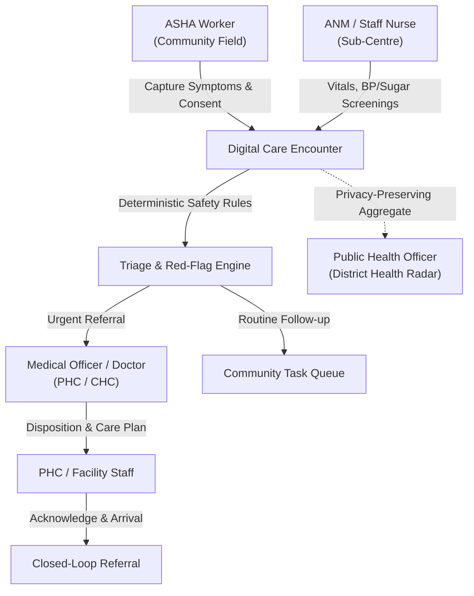

# ArogyaSaathi — Product Blueprint
**Document ID:** DOC-BLU-001  
**Product:** ArogyaSaathi — AI-Assisted Rural Healthcare Coordination & Public Health Intelligence Platform  
**Tagline:** “Har Gaon, Har Ghar, Swasth Bharat” (Health for Every Indian)  
**Status:** Canonical Product Specification  

---

## 1. Product Identity & Core Purpose

ArogyaSaathi is an enterprise-grade, mobile-first, voice-assisted healthcare coordination platform engineered specifically for the realities of rural and primary healthcare in India. 

Primary health systems in rural geographies face chronic challenges: fragmented paper records, lost referrals between sub-centres and district hospitals, missed follow-ups for chronic non-communicable diseases (hypertension, diabetes), and delayed aggregation of community health signals.

ArogyaSaathi connects community health workers (ASHAs), auxiliary nurse midwives (ANMs), medical officers (doctors), primary health centre (PHC) staff, and public health officials into a synchronized, consent-aware care coordination continuum. Every patient interaction is converted into a structured, auditable care event.

---

## 2. Core Product Principles

1. **Safety Before Automation**:
   - The platform strictly prohibits autonomous clinical diagnosis, drug prescription, and AI-determined clinical urgency.
   - With explicit consent, generative AI may provide general health information, conversational symptom intake, and non-diagnostic observations of submitted images; speech models may transcribe or speak conversations.
   - Chat messages and selected images are sent to the configured OpenAI service only after the user consents. API credentials remain server-side; users are told not to submit identifying patient information.
   - All red-flag escalations and triage alerts are governed exclusively by **clinician-approved, versioned, deterministic rule engines**.

2. **Human Accountability for Clinical Decisions**:
   - Every referral disposition, protocol change, emergency escalation, and outbreak candidate alert requires explicit human review and authentication.

3. **Privacy by Design & Scoped Access**:
   - Operates on strict Role-Based Access Control (RBAC) combined with geographic/facility scoping (district -> block -> PHC -> village).
   - Enforces purpose-specific patient consent with full auditability of sensitive record access, corrections, and data exports.

4. **Accessible, Mobile-First & Low-Bandwidth Resilience**:
   - Designed for low-end Android mobile devices and unstable 2G/3G/4G connectivity.
   - Light asset footprints, keyboard navigation, high contrast UI, and clear status indicators.

5. **Honest, Evidence-Based Product Claims**:
   - No fabricated real-world patient counts, clinical validation certificates, or government endorsements.
   - Unimplemented or planned features are clearly labelled as **"Planned (Phase 2/3)"**; demo interfaces utilize transparently labelled synthetic fixtures.

---

## 3. User Personas & Permissions Matrix

### Detailed Persona Profiles

| Role | Operational Setting | Primary Platform Responsibilities | Data Access Scope |
| :--- | :--- | :--- | :--- |
| **ASHA Worker** | Village / Household visits | Patient registration, voice symptom capture, BP/glucose reminders, assigned follow-up execution | Assigned village(s) and assigned patient list |
| **ANM / Nurse** | Sub-Centre / Health & Wellness Centre | Recording clinical vitals, chronic disease screenings, reviewing escalations from ASHAs | Assigned sub-centre jurisdiction / cluster of villages |
| **Medical Officer (Doctor)** | Primary Health Centre (PHC) / CHC | Reviewing structured referral packets, clinical disposition, telemedicine triage, care plan authorization | Assigned facility and inbound referred patients |
| **PHC / Facility Staff** | Facility Administration | Referral intake, bed/clinic arrival logging, appointment acknowledgement, handoff tracking | Receiving facility records |
| **Public Health Officer** | Block / District Health Office | Monitoring syndromic disease trends (Health Radar), investigating outbreak candidate alerts | Aggregate village/block statistics; restricted patient-identifiable data |
| **District Programme Manager** | District Administration | Monitoring ASHA workload, chronic disease coverage, referral completion rates, service bottlenecks | Aggregated district operational KPIs |
| **System Administrator** | IT Operations / Governance | Managing user credentials, facility hierarchy, role assignments, protocol version rollouts, audit reviews | Administrative scope; strictly non-clinical |

---

## 4. Key End-to-End Workflows

### 4.1 The 5-Step Core Care Coordination Journey
1. **Step 1 — Register Patient**: Community worker looks up existing patient or initiates consent-aware digital registration (capturing name, age, village, contact, and specific consent purpose).
2. **Step 2 — Capture Information**: Health worker speaks naturally in local dialect (Hindi/regional) or enters structured text; speech-to-text generates editable transcript; structured symptoms (duration, severity) are extracted.
3. **Step 3 — Safety Check**: Deterministic safety engine evaluates extracted symptoms against versioned clinician-approved protocols. Missing safety-critical inputs are flagged; red flags trigger immediate escalation.
4. **Step 4 — Take Action**: Based on safety evaluation, a structured referral is dispatched to the nearest appropriate facility, or a localized care plan / follow-up task is scheduled.
5. **Step 5 — Track & Monitor**: Facility staff acknowledge patient arrival; medical officer logs disposition; completed care instructions automatically generate follow-up reminders for the village ASHA.

---

## 5. Release Roadmap Scope

- **Release 1 (Current Scope — Phase 1 & 2 Focus)**:
  - Clean monorepo foundation with Next.js web application and FastAPI backend scaffolding.
  - Complete premium public website UI with English/Hindi localized navigation, 9 feature showcases, 5-step interactive workflow, honest target metrics, accessible forms, and development authentication entry points.
  - Core design system, design tokens, and documentation suite.
- **Release 1 Hardening (Subsequent Phase 3)**:
  - Synthetic patient registry, consent lifecycle, non-voice encounter forms, deterministic red-flag engine, and closed-loop referral tracking with mock data.
- **Release 2 (Phase 4)**:
  - Multilingual voice-triage audio pipeline with transcript editor and manual fallback; chronic care BP/glucose trend tracking.
- **Release 3 (Phase 5+)**:
  - Health Radar public health surveillance, advanced analytics, and offline PWA synchronization.
