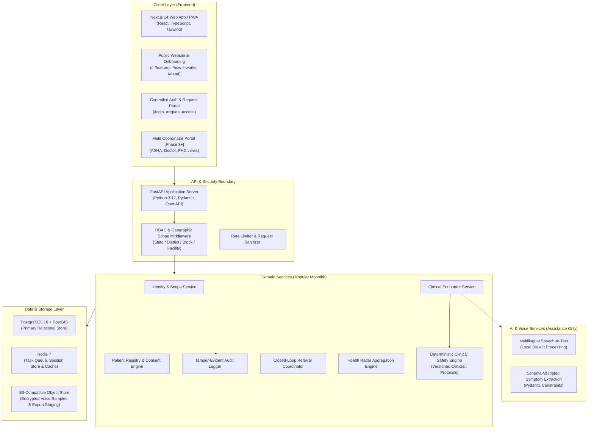

# ArogyaSaathi — Technical Architecture Specification
**Document ID:** DOC-ARCH-001  
**Product:** ArogyaSaathi  
**Status:** Canonical System Architecture  

---

## 1. System Topology & Layered Architecture

ArogyaSaathi adopts a **modular monolith** approach for its core healthcare coordination and surveillance services, ensuring operational simplicity, high transaction integrity, and low hosting overhead during pilot rollouts.

---

## 2. Technical Stack Specifications

### 2.1 Frontend (`apps/web`)
- **Framework:** Next.js 14 (App Router architecture with React Server Components and targeted Client Components for interactive states).
- **Language:** TypeScript 5.6+ with strict mode enabled (`noImplicitAny`, `strictNullChecks`).
- **Styling:** Tailwind CSS 3.4 utilizing a custom design token configuration matching healthcare greens, mint surfaces, and semantic alert states.
- **Icons:** `lucide-react` for accessible, lightweight SVG iconography.
- **Localization:** Typed client-side i18n context supporting English and Hindi with runtime toggling.
- **State & Forms:** Controlled components with native HTML5 accessible validation attributes and keyboard event handlers.

### 2.2 Backend (`backend/app`) — Architecture for Phase 3+
- **Framework:** FastAPI (Python 3.12) with asynchronous request handlers.
- **Data Validation & Schemas:** Pydantic v2 for strict request and response contract validation.
- **ORM & Migrations:** SQLAlchemy 2.0 (async session) and Alembic for declarative, version-controlled schema migrations.
- **Task Queue & Background Jobs:** Celery / ARQ backed by Redis for asynchronous notifications, referral escalation reminders, and public health signal aggregation.

### 2.3 Deterministic Clinical Safety Engine
- **Core Principle:** Isolated Python module with **zero reliance on generative LLMs**.
- **Operation:** Evaluates structured clinical symptoms, duration, and patient risk factors against approved, versioned JSON-based clinical protocol specifications (e.g. Protocol `MATERNAL_V1`, `ACUTE_FEVER_V1`, `CHRONIC_HYPERTENSION_V2`).
- **Audit Requirement:** Every rule evaluation produces an immutable record: `rule_id`, `protocol_version`, `input_snapshot`, `output_decision`, `escalation_level`, `timestamp`, and `evaluating_actor_id`.

---

## 3. Security, Privacy & Compliance Architecture

1. **Role-Based Access Control (RBAC) with Spatial Scoping**:
   - Access is not determined by role alone. Every query is filtered by the user's geographic and organizational scope:
     `SELECT * FROM patients WHERE village_id IN (SELECT village_id FROM user_village_scopes WHERE user_id = :current_user_id)`.
   - Hiding buttons in the UI is never treated as an authorization boundary.
2. **Consent-Aware Processing (Digital Personal Data Protection Act Alignment)**:
   - Every patient record links to an explicit `consent_record` specifying consent purpose (routine care, referral coordination, anonymized research), version, timestamp, and recorder ID.
   - Consent withdrawal immediately flags the profile and suspends outbound referral sharing.
3. **Tamper-Evident Audit Logging**:
   - All sensitive data reads, patient record creations, referral status updates, safety rule evaluations, and data exports are logged to an append-only `audit_events` table.
4. **Synthetic Data Mandate for Development & Demonstrations**:
   - The platform strictly separates production environments from development environments.
   - All sample records, previews, and test fixtures are explicitly generated from synthetic models and flagged with `is_synthetic: true`.

